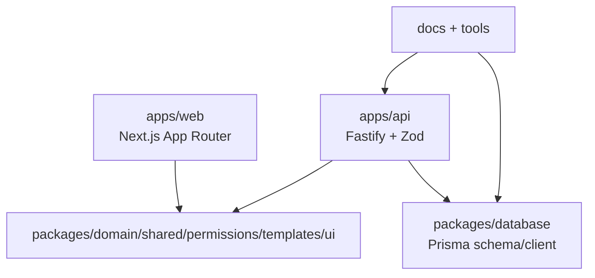
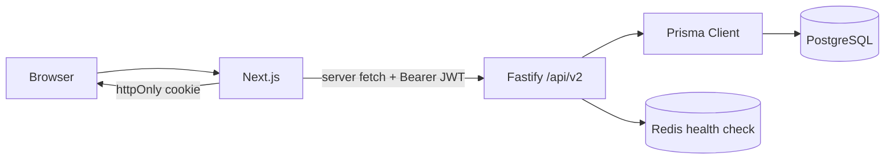
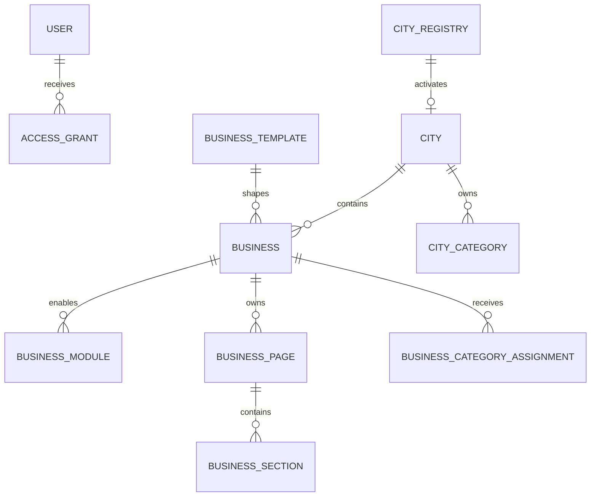
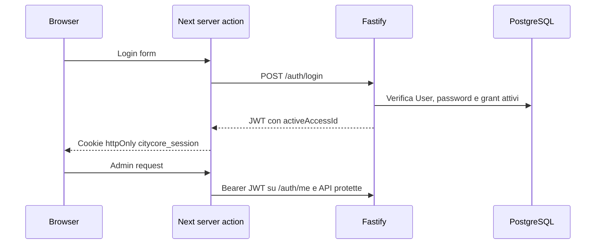
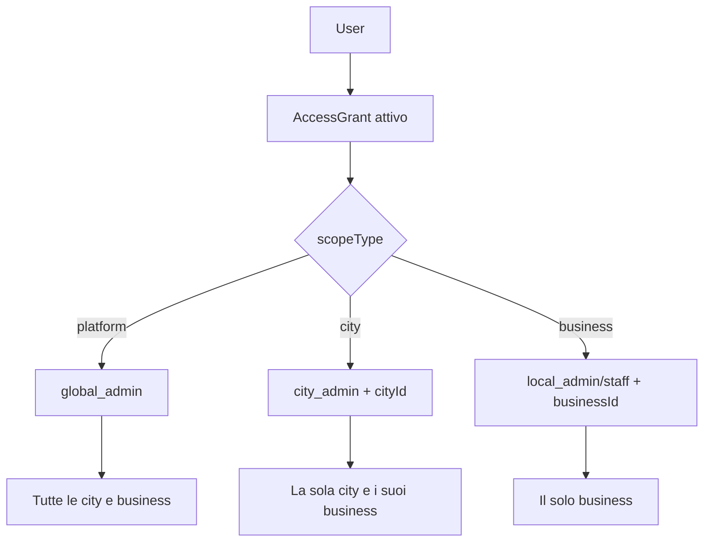

# Architettura corrente verificata

Questa e l'architettura presente nel codice al 2026-08-05. Non implica che gli
scaffold di moduli, pagine, sezioni, media o collezioni siano gia esposti.

## Monorepo



## Frontend, API e dati



Il frontend usa le API pubbliche per city/business e le API protette per admin.
Quando queste non rispondono, il runtime pubblico puo usare fallback editoriali
statici: non e una sorgente dati primaria.

## Modello Platform → City → Business



`BusinessPage`, `BusinessSection`, categorie e assegnazioni esistono nel
database, ma non fanno parte del runtime/API MVP corrente.

## Autenticazione



Il token e firmato HMAC, include `authVersion` e `activeAccessId`; revocare o
incrementare la versione dell'utente invalida la sessione alla successiva
verifica. Non esiste refresh token.

## Ruoli e access grant



I filtri `buildAccessibleCityFilter` e `buildAccessibleBusinessFilter`
restringono le query admin. Le mutate route rileggono l'entita e controllano
permesso e scope prima dell'update; un local admin non ottiene dati di un altro
business tramite le route esaminate.

## Flusso pubblico attuale

```mermaid
flowchart LR
  H[/] --> PC[/public/cities + /public/businesses]
  PC --> C[/:citySlug]
  C --> CB[/public/cities/:citySlug/businesses]
  CB --> B[/:citySlug/:businessSlug]
  B --> PB[/public/cities/:citySlug/businesses/:businessSlug]
  PC -. API non raggiungibile .-> F[Fallback editoriale statico]
  CB -. API non raggiungibile .-> F
  PB -. API non raggiungibile .-> F
```

Le route pubbliche includono city attive/non disabilitate e business `active`.
Non includono ancora ricerca, filtri, servizi, orari, pagine/section pubblicate
o invio richiesta di contatto.
