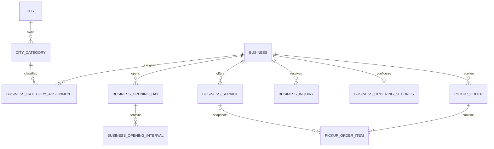

# Data model

La Fase 2 riusa `CityCategory` e `BusinessCategoryAssignment`; aggiunge
`BusinessService`, `BusinessOpeningDay`, `BusinessOpeningInterval` e
`BusinessInquiry`. Gli orari usano una riga giornaliera e intervalli figli:
supportano chiusura e note senza serializzare JSON. Gli intervalli oltre la
mezzanotte sono esplicitamente vietati.

Categorie: slug unico per city, parent nella stessa city e solo due livelli;
non sono eliminabili con figli o assegnazioni. Le assegnazioni richiedono
categorie attive della city del business.

La pubblicazione usa `Business.status = active` e `publishedAt`; richiede city
attiva, descrizione, categoria attiva e contatto pubblico. I servizi pubblici
usano `PublicationStatus.published`. Inquiry: `new -> read -> closed`.

Indici aggiunti: servizio `(businessId,status,sortOrder)`, giorno/interval
orari, inquiry `(businessId,status,createdAt)` e unicita servizio per slug.

Il pickup ordering usa `BusinessOrderingSettings`, `PickupOrder` e
`PickupOrderItem`. Gli item conservano nome e prezzo come snapshot e il
collegamento al servizio può diventare nullo. Questi modelli supportano soltanto
l'estensione dimostrativa opzionale: non sono requisiti di readiness o publish.
